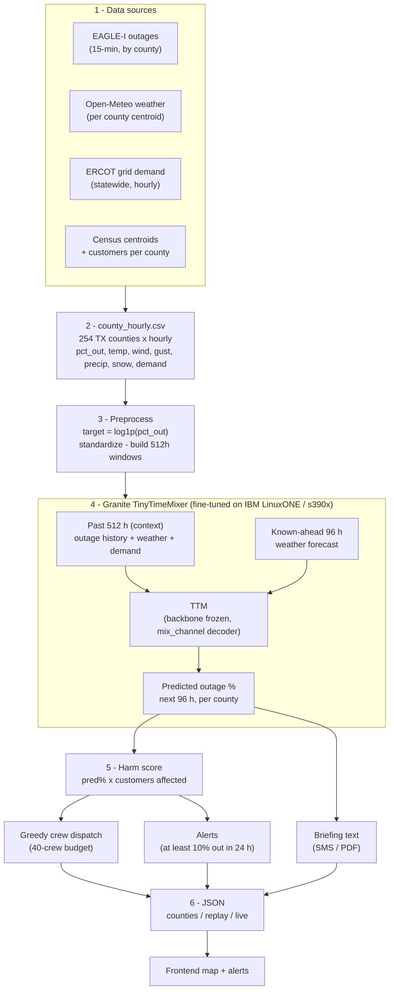
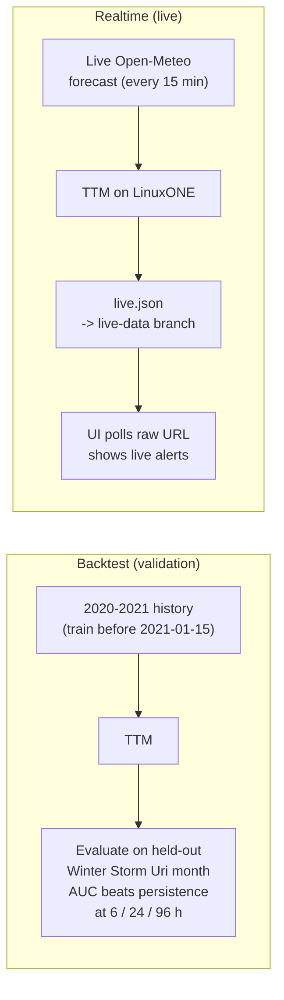

# How the Uri Watch model works

## End-to-end pipeline

## Two run modes

## In one sentence

The model takes **512 hours of history** (each county's recent outages, weather, and
statewide grid demand) plus the **96-hour-ahead weather forecast**, and outputs each
county's **predicted outage percentage for the next 96 hours**. Those predictions feed a
harm score, a greedy crew-dispatch allocator, and threshold alerts, which the frontend
renders on a map. The model is a fine-tuned IBM **Granite TinyTimeMixer**, trained and
served on an IBM **LinuxONE (s390x)** instance, and validated by holding out the Winter
Storm Uri month (Feb 2021), where it beats a persistence baseline on AUC at every horizon.
